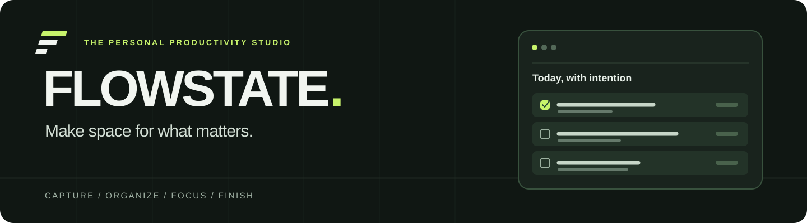

<p align="center">
  <strong>A calmer way to plan, finish, and focus.</strong><br>
  A personal productivity studio that lives in your browser.
</p>

<p align="center">
  <a href="#get-started">Get started</a> ·
  <a href="#how-it-works">How it works</a> ·
  <a href="#your-data">Your data</a> ·
  <a href="#for-developers">For developers</a>
</p>

---

## The workspace, in two lights

The same considered workspace in both themes. The screenshots show the actual application; the task in the dark preview was created for an isolated browser check. **Your first launch starts with an empty workspace.**

| Light · Today | Dark · All tasks |
| :---: | :---: |
|  |  |

<p align="center"><sub>Open either image to see it at full size.</sub></p>

### Built around the work itself

| Plan | Focus | See your progress |
| --- | --- | --- |
| Capture tasks in one line, then organize them by date, project, priority, and workflow stage. | Work with a task-linked 25-minute timer and short or long breaks. | Review task completions and focus sessions calculated from your own saved activity. |

No account, backend, API key, or runtime package is required.

## Get started

**Requirement:** Node.js 20 or newer.

```sh
npm run dev
```

Open **[localhost:5173](http://localhost:5173)**. There is no `npm install` step: the app uses only browser APIs and Node's built-in modules. Use the local server rather than opening `index.html` directly, so JavaScript modules load correctly.

> **Returning to your tasks?** Keep using the same browser and address. Browser storage for `localhost:5173`, `127.0.0.1:5173`, and other ports is separate.

## How it works

### 1. Capture what matters

Type into **“What’s your next move?”** and select **Add task**. FLOWSTATE opens a review form, where you can add a description, project, priority, due date, estimated duration, and workflow status. A title is required; duplicate titles are welcome.

Quick Add understands practical shorthand:

```text
Finish assignment tomorrow #university !high 45m
```

| Parsed field | Result |
| --- | --- |
| Title | Finish assignment |
| Due | Tomorrow, using your local calendar |
| Project | university |
| Priority | High |
| Estimate | 45 minutes |

You can also use `today`, `!medium`, `!low`, `25m`, or `1h`. The parser follows deterministic rules and **shows the result before saving**. It never invents a deadline; unknown words remain in the title. Conflicting shorthand stays visible with a warning.

### 2. Move work forward

Select the circle beside a task to complete it, or select it again to reopen it. Select a task title to edit its details. The task menu contains **Focus**, **Edit**, and **Delete**; deletion offers a **12-second Undo** action.

Use the view that suits the moment:

| View | Best for |
| --- | --- |
| **Today** | Overdue work, today's deadlines, high priorities, and tasks already in progress |
| **Upcoming** | Future deadlines, grouped by day |
| **All tasks** | The full collection, with All / Active / Completed filters, search, and sorting |
| **Board** | Moving work through To Do, In Progress, and Done |
| **Completed** | Reviewing finished work and reopening a task |

Search covers titles, descriptions, and projects. Filter by priority or project; sort by priority, due date, newest, or title. Edits and status changes carry through every view.


### 3. Make room to focus

Open **Focus studio** from navigation, a task menu, or the command menu. Choose a task or start open focus. The studio offers a **25-minute focus session**, a **5-minute short break**, and a **15-minute long break**, with start, pause, resume, and reset controls.

The countdown uses an absolute end time, so it catches up after an inactive tab. A completed focus session is recorded once; it does not automatically mark the task complete. Breaks do not count as focus sessions. Changing a running or paused preset asks before resetting the timer.

### 4. Reflect on real progress

The workspace reports completed tasks today, remaining work, overall completion, seven days of activity, and completed focus sessions from stored history. Small milestones unlock from actual activity. A new workspace shows **zero activity**, never fabricated statistics.

## Make it yours

Open **Settings & data** to set your first name and daily intention, choose light or dark appearance, and manage backups. The selected theme persists across refreshes. Both themes, dialogs, menus, and the Focus studio use the same design system.

| Shortcut | Action |
| --- | --- |
| `N` | New task |
| `/` | Focus task search |
| `Ctrl+K` or `Cmd+K` | Open the command menu |
| `↑` / `↓`, then `Enter` | Choose a command |
| `Escape` | Close an active dialog or task menu |

Global shortcuts do not interrupt typing in a form. Dialogs support keyboard navigation, visible focus, and the system reduced-motion preference.

## Your data

Tasks and preferences are stored in browser `localStorage` under `flowstate.v1`; the active timer uses `flowstate.timer.v1`. **This data belongs to this browser and site address. It is not cloud backup.** Clearing site data removes it.

Use **Settings & data → Export JSON** to save a backup. **Import JSON** validates the file and asks before replacing your workspace. Export before moving to another browser or device.

If saved data becomes unreadable, FLOWSTATE offers a recovery path rather than crashing. When you choose a fresh workspace, it retains the unreadable original under `flowstate.recovery`. A closed browser cannot send a timer notification; elapsed sessions are reconciled when you return.

## For developers

FLOWSTATE is a dependency-free **HTML, CSS, and JavaScript** application. Task rules, rendering, and styling have separate homes:

| File | Role |
| --- | --- |
| `index.html` | Semantic workspace, forms, and dialogs |
| `styles.css` | Design tokens, themes, responsive layouts, and motion |
| `model.js` | Tasks, Quick Add, local dates, import validation, and metrics |
| `app.js` | Rendering, interactions, persistence, timer, and data tools |
| `scripts/` | Local server, static build, and checks |
| `tests/` | Automated tests and isolated browser fixtures |

| Command | What it does |
| --- | --- |
| `npm run dev` | Serve the app on port 5173 |
| `npm run lint` | Check JavaScript syntax and duplicate HTML IDs |
| `npm test` | Run the model and data-integrity tests |
| `npm run build` | Create the static production site in `dist/` |
| `node scripts/server.mjs --dist` | Preview the production build |

To use another port in PowerShell:

```powershell
$env:PORT='5174'; npm run dev
```

`dist/` can be hosted as a static site. Browser storage remains tied to the deployed origin.

### Verification

The latest application checks passed: `npm run lint`, **13 automated tests** via `npm test`, and `npm run build`. Browser checks covered task creation and completion, status filtering, Board updates, theme persistence, mobile dialogs, Focus access, and console errors. Board layouts were checked at **1440, 1280, 1024, 768, 390, and 320 px** without horizontal overflow. Earlier browser checks covered editing, Undo, timer controls, export/import, and corrupted-data recovery.

Physical touch-device and full screen-reader testing, a full 25-minute wall-clock run, and a fresh browser file-picker import check remain manual verification items. The isolated recovery/timer fixture is `tests/browser-fixture.html`; **opening it on a real workspace origin can replace that origin's data**.

---

<p align="center"><strong>FLOWSTATE</strong> · Make space for what matters.</p>
