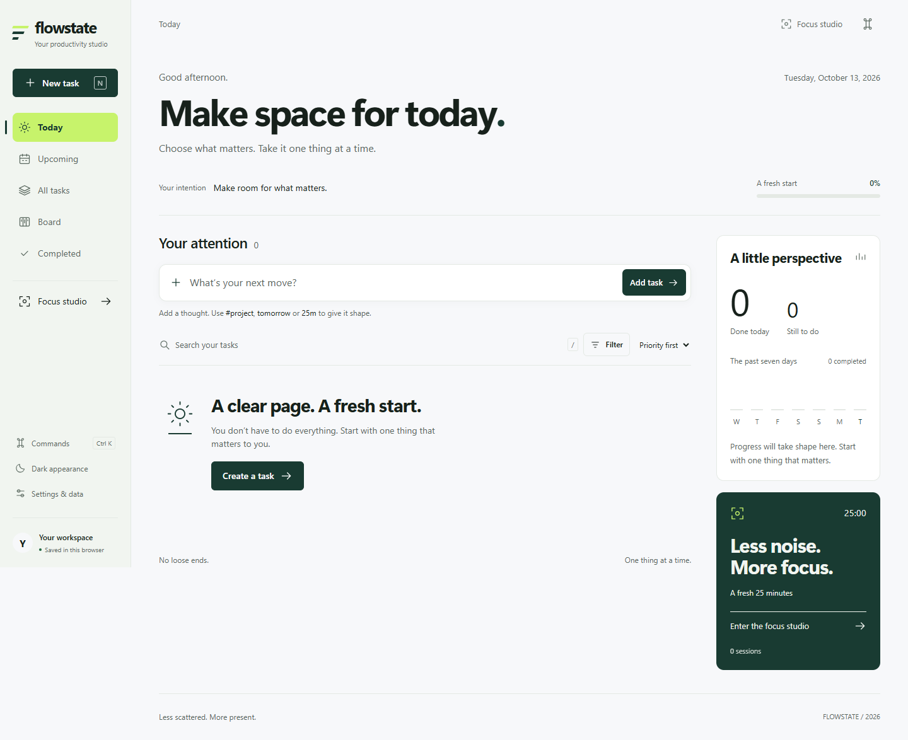
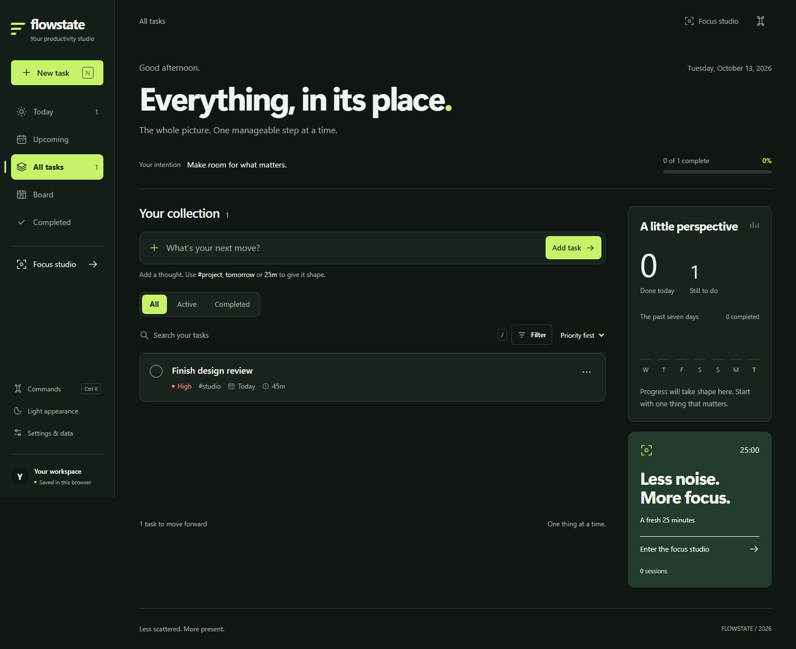
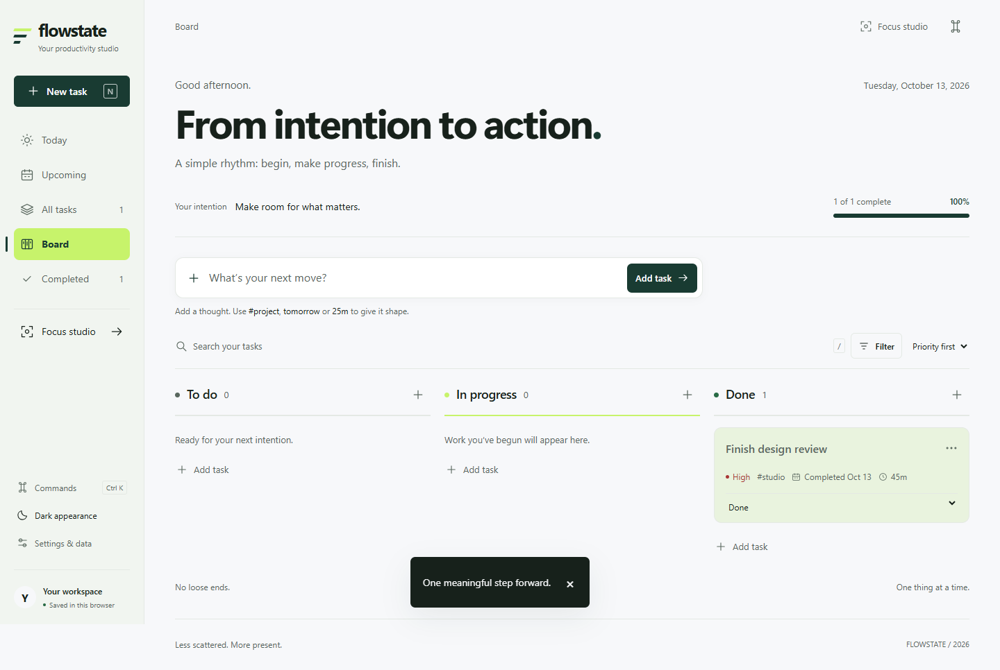

# FLOWSTATE

**Make space for what matters.** A personal task and focus workspace with a calm forest-and-lime identity, useful progress tracking, and no account to create.

`Vanilla HTML + CSS + JavaScript` · `Light & dark themes` · `Browser-local data` · `Zero runtime dependencies`



<details>
<summary><strong>See the dark theme and Board</strong></summary>

### Dark theme · All Tasks



### Board · three-stage workflow



</details>

The sample task in these previews was created for a browser check. A first-time workspace starts empty.

## Start in under a minute

1. Install **Node.js 20 or newer**.
2. In this project folder, run:

   ```sh
   npm run dev
   ```

3. Open **[http://localhost:5173](http://localhost:5173)**.

There is no `npm install` step. The app has no runtime packages, account, backend, or API key. Open it through the development server; double-clicking `index.html` will not load its JavaScript modules correctly.

> **Keep the same address when you return.** Browser storage for `localhost:5173` is separate from `127.0.0.1:5173` and from other ports.

## Your first task

1. Type into **“What’s your next move?”** and choose **Add task**, or press **N** to open the full form.
2. Review the title, then add a description, priority, project, due date, time estimate, or workflow status if useful. Save the task.
3. Select the circle beside a task to complete it. Select it again to reopen it.
4. Select the task title to edit it. The **···** menu offers Focus, Edit, and Delete. Deletion shows an **Undo** action for 12 seconds.

Task titles must contain text; duplicate titles are allowed. Changes appear immediately and persist in this browser after refresh.

### Quick Add shorthand

For example, type:

```text
Finish assignment tomorrow #university !high 45m
```

FLOWSTATE opens a review form with **Finish assignment** as the title, **tomorrow** as the due date, **university** as the project, **high** priority, and a **45-minute** estimate.

| Shorthand | Meaning |
| --- | --- |
| `today`, `tomorrow` | Local-calendar due date |
| `#project` | Project or category |
| `!high`, `!medium`, `!low` | Priority |
| `25m`, `1h` | Estimated duration |

Quick Add follows deterministic rules. It never assumes a deadline. Unknown words stay in the title; conflicting shorthand stays visible with a warning so you can correct it before saving.

## Find the right view

| View | What it shows |
| --- | --- |
| **Today** | Unfinished work that is overdue, due today, high priority, or in progress. |
| **Upcoming** | Unfinished tasks with future due dates, grouped by day. |
| **All Tasks** | The full collection, with **All / Active / Completed** status controls. |
| **Board** | To Do, In Progress, and Done columns. Create in a column or move a task with its workflow selector. |
| **Completed** | Finished tasks, newest completions first; reopen from here. |

Search matches task titles, descriptions, and projects. The Filter control narrows by priority or project; Sort offers priority, due date, newest, and title order. Your data stays consistent when you switch views.

## Focus and progress

Open **Focus studio** from the sidebar, top bar, task menu, or command menu. Choose a task or leave it as open focus, then start a **25-minute** session. You can pause, resume, reset, or switch to a **5-minute short break** or **15-minute long break**. Switching a running or paused session asks before resetting its timer.

The timer uses an absolute end time, so it catches up when a tab was inactive. A finished focus session is saved once and appears in your session count; it does **not** silently complete the task. Breaks do not count as focus sessions.

The progress area uses real stored history: tasks completed today, tasks remaining, overall completion percentage, seven days of completions, focus sessions, and small earned milestones. An empty workspace shows zero activity rather than sample statistics.

## Personalize and protect your work

Open **Settings & data** to set your first name and daily intention, switch themes, **Export JSON**, or **Import JSON**. The theme choice persists after refresh. Import validates the backup and asks before replacing the current workspace.

Tasks and preferences are stored in `flowstate.v1`; the active timer is stored in `flowstate.timer.v1`. This is **localStorage: it belongs to this browser and origin, and it is not a cloud backup**. Clearing browser site data removes it. Export a JSON backup regularly, especially before changing devices or browsers.

If saved data is unreadable, the app shows a recovery path instead of crashing or overwriting it. The original data is retained under `flowstate.recovery` when you choose a fresh workspace. A running timer cannot send a notification while the browser is closed; elapsed sessions are reconciled when you return.

## Keyboard shortcuts

| Keys | Action |
| --- | --- |
| `N` | Open a new task |
| `/` | Focus task search |
| `Ctrl+K` / `Cmd+K` | Open the command menu |
| `↑` / `↓`, then `Enter` | Choose a command |
| `Escape` | Close an active dialog or task menu |

Global shortcuts stay inactive while you type in a form. Dialogs support Tab navigation and visible focus states. Motion respects the system reduced-motion preference.

## Develop and verify

| Command | Purpose |
| --- | --- |
| `npm run dev` | Start the local server on port 5173 |
| `npm test` | Run the 13 model and integrity tests |
| `npm run lint` | Check JavaScript syntax and duplicate HTML IDs |
| `npm run build` | Copy production assets into `dist/` |
| `node scripts/server.mjs --dist` | Preview the production build |

`dist/` can be hosted as a static site. To use another port in PowerShell:

```powershell
$env:PORT='5174'; npm run dev
```

### Project map

| Path | Responsibility |
| --- | --- |
| `index.html` | Semantic workspace, forms, and dialogs |
| `styles.css` | Design tokens, themes, responsive layout, and motion |
| `model.js` | Task rules, Quick Add parser, local dates, schema validation, and metrics |
| `app.js` | Rendering, interactions, persistence, timer, and data tools |
| `scripts/` | Local server, static build, and checks |
| `tests/` | Automated tests and isolated browser fixtures |
| `docs/screenshots/` | Screenshots used in this README |

### Verification

The latest `npm run lint`, `npm test` (**13 passed**), and `npm run build` checks passed. Browser checks covered task creation, completion, status filtering, Board updates, theme persistence, mobile dialogs, Focus access, and console errors. Board layouts were checked at 1440, 1280, 1024, 768, 390, and 320 pixels without horizontal overflow. Earlier browser checks also covered editing, undo, timer controls, export/import, and corrupted-data recovery.

Physical touch-device and full screen-reader testing, a full 25-minute wall-clock timer run, and a fresh browser file-picker import check remain manual verification items. For isolated recovery/timer QA, see `tests/browser-fixture.html`; **its controls replace disposable data on the origin where it is opened**.
